

  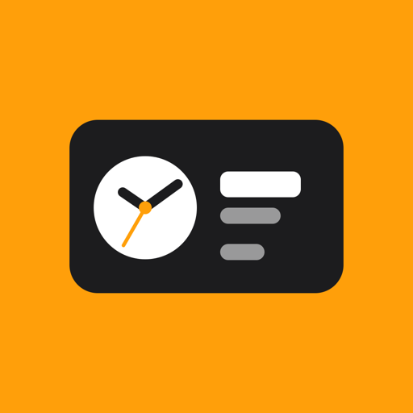

<h1 align="center">待機模式 for iPad</h1>

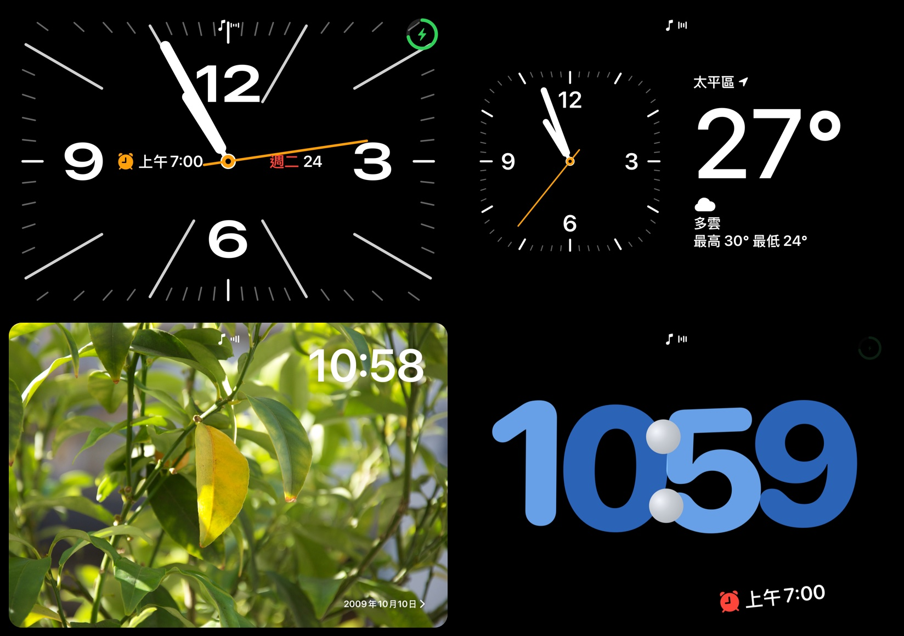

## 下載

到 [Releases](https://github.com/PACO630/StandByPad/releases/latest) 下載 `StandByPad-v1.0.1.ipa`（未簽名），用 Sideloadly 或 AltStore 等工具以你的 Apple ID 簽名後安裝到 iPad。

## 功能介紹

### 三個畫面

和 iPhone 一樣，待機模式有三個畫面，**左右滑動**切換：

| 小工具 | 電子相框 | 全螢幕時鐘 |
| :---: | :---: | :---: |
| 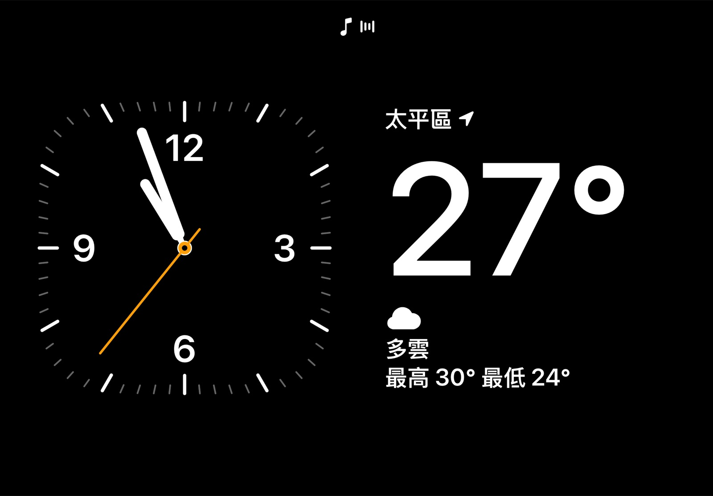 | 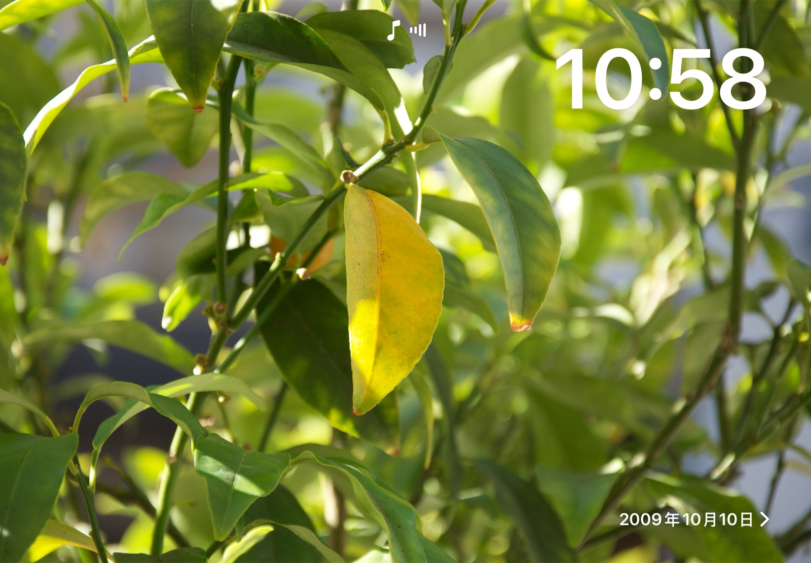 | 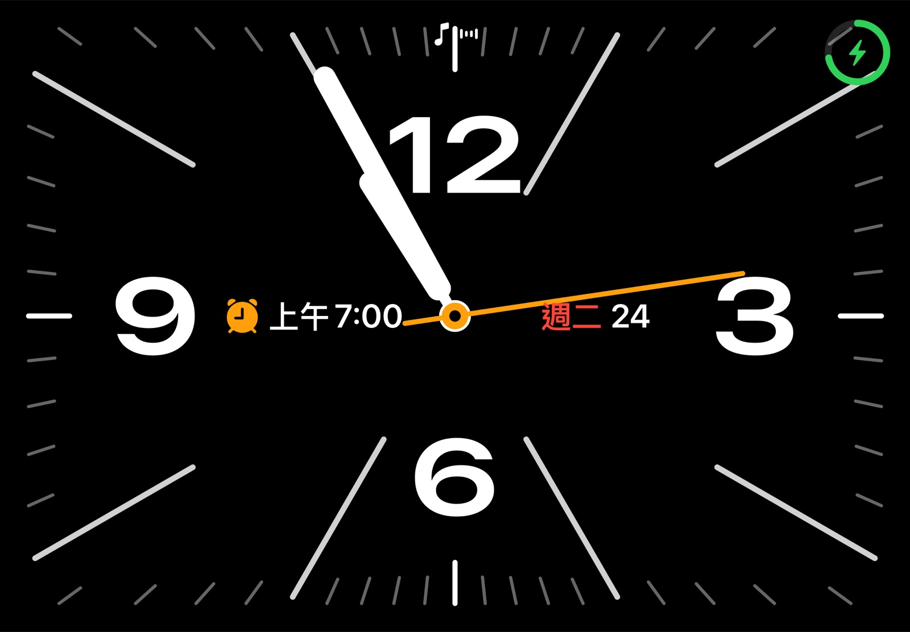 |

### 智慧型堆疊與小工具

左右各有一個「智慧型堆疊」，**上下滑動**切換堆疊裡的小工具，滑動時右側會出現頁面圓點。

| | |
| :---: | :---: |
|  | 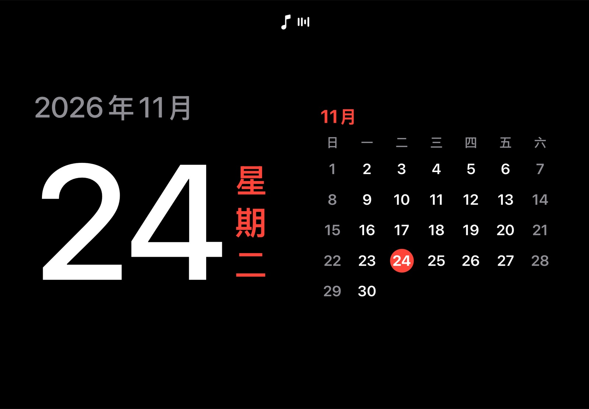 |
| 時鐘（圓角方形刻度）＋目前天氣 | 日期（直排星期）＋月曆 |
| 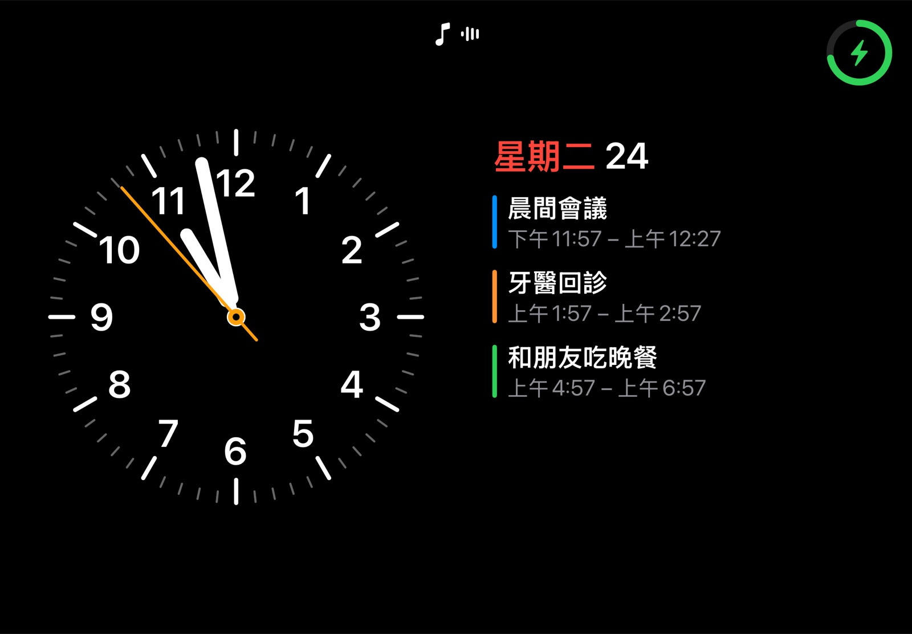 | 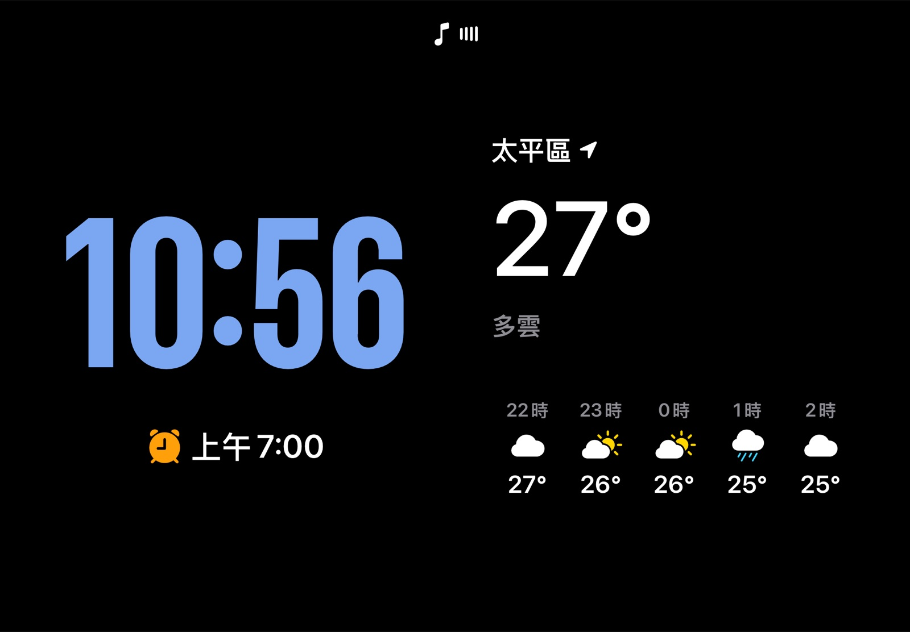 |
| 經典時鐘＋即將到來的行程 | 數字時鐘＋下一個鬧鐘＋每小時預報 |
| 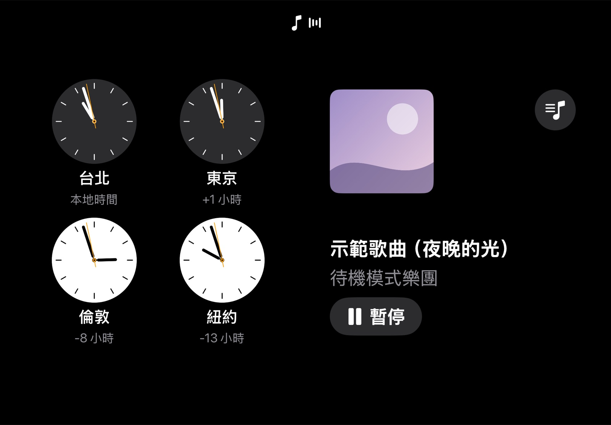 | 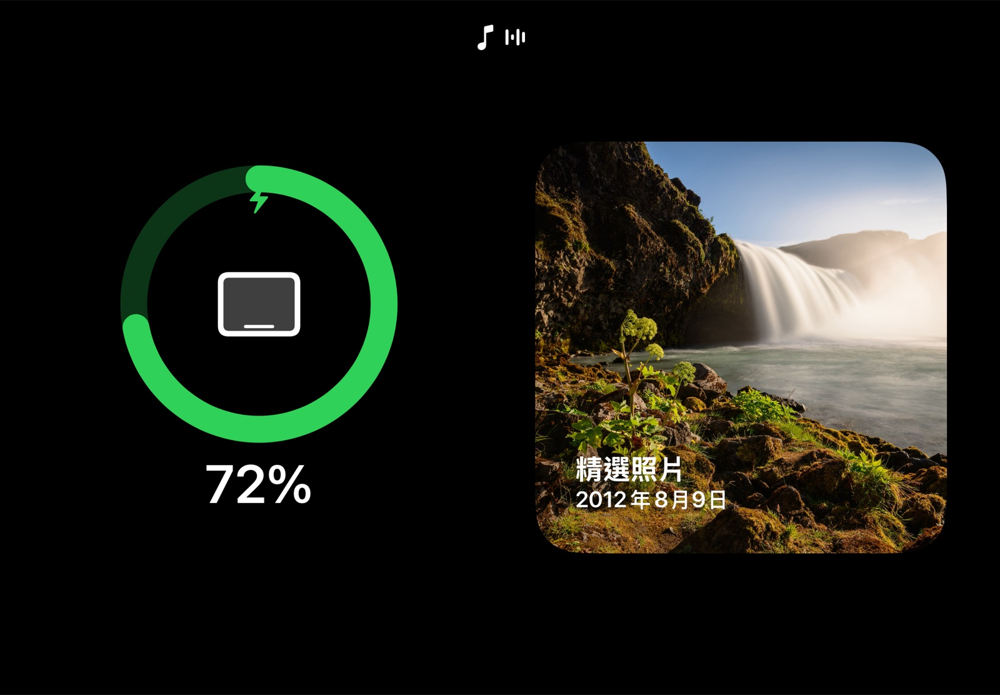 |
| 世界時鐘（白天白色錶面、晚上深色）＋聆聽活動 | 電池＋精選照片 |

**全部 12 種小工具**

| App | 小工具 | 內容 |
| --- | --- | --- |
| 時鐘 | 時鐘 | 待機模式招牌的圓角方形刻度錶盤，秒針連續走動 |
| 時鐘 | 經典時鐘 | 1–12 數字的圓形錶盤 |
| 時鐘 | 數字時鐘 | 大字數字時間與下一個鬧鐘 |
| 時鐘 | 世界時鐘 | 台北、東京、倫敦、紐約，白天／夜晚錶面自動切換 |
| 行事曆 | 日期 | 年月、大字日期、直排的星期 |
| 行事曆 | 月曆 | 本月日曆，今天以紅圈標示，週末為灰色 |
| 行事曆 | 即將到來 | 接下來的三個行程，顯示行事曆顏色與時間 |
| 天氣 | 目前天氣 | 地區、溫度、天氣狀況、最高／最低溫 |
| 天氣 | 每小時預報 | 接下來五個小時的天氣與溫度 |
| 音樂 | 聆聽活動 | 專輯封面、歌名、歌手、播放／暫停，右上角可開啟音樂資料庫 |
| 照片 | 精選照片 | 每小時換一張你的照片 |
| 電池 | 電池 | iPad 電量圈，充電中顯示閃電 |

**智慧型輪替**：閒置 90 秒後，堆疊會自動切到當下最相關的小工具，例如：

- 正在播放音樂 → 聆聽活動
- 一小時內有行程 → 即將到來
- 早上 6–10 點 → 天氣
- 晚上 9 點後 → 數字時鐘與鬧鐘
- 電量低於 20% → 電池

**小工具建議**：正在播放音樂、但兩個堆疊都沒有音樂小工具時，會暫時把它加進右側堆疊。

### 編輯堆疊與小工具庫

**長按**任一個堆疊進入編輯模式：

- 堆疊縮成卡片，左上角「−」移除小工具（會先確認）。
- 左上角「+」開啟小工具庫。
- 右側可開關「智慧型輪替」與「小工具建議」。
- 右上角是「設定」與「完成」。

| 編輯堆疊 | 小工具庫：建議 | 小工具庫：單一 App |
| :---: | :---: | :---: |
| 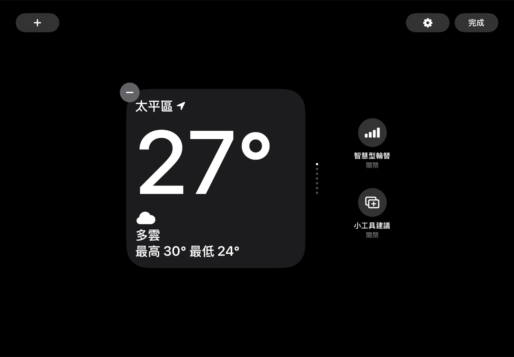 | 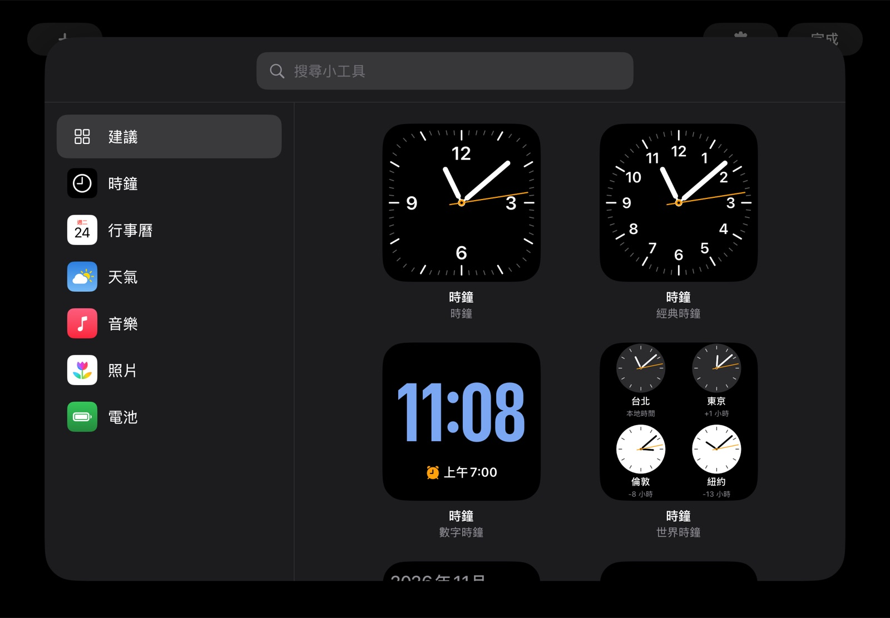 | 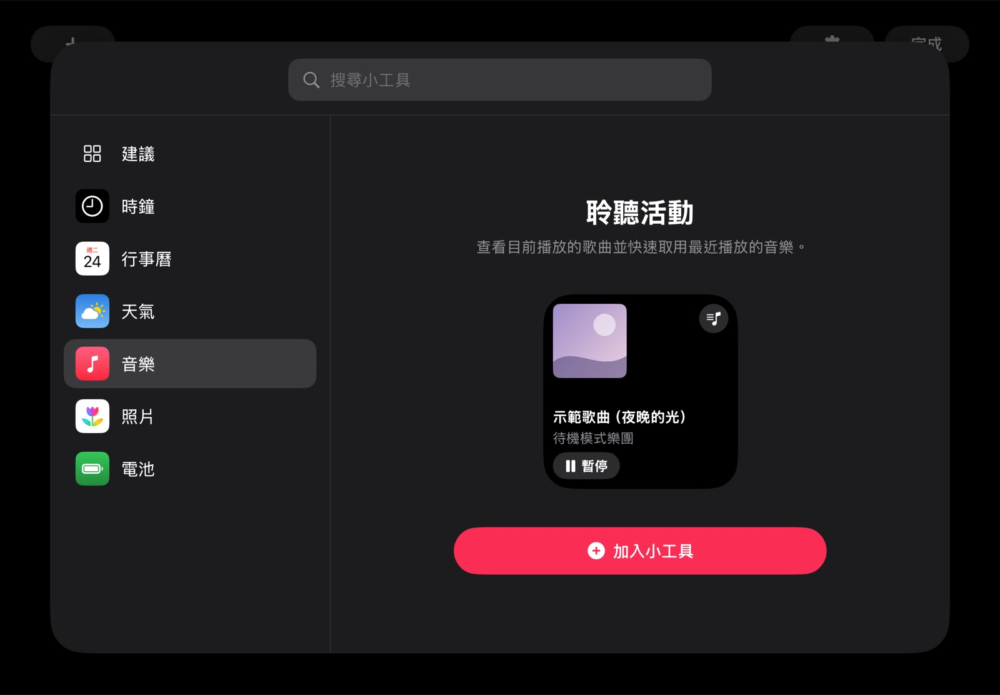 |

小工具庫上方可以搜尋，左側列出 App。點一個 App 可以左右滑動預覽它的所有小工具，再按「加入小工具」。

### 電子相框

第二個畫面會輪播你的照片，像電子相框一樣：

- 每 9 秒換一張，淡入淡出並緩慢推近。
- 右上角顯示時間，右下角顯示拍攝地點與日期。點地點和日期可以打開「照片」App。
- **上下滑動**切換相簿：精選照片（喜好項目）、最近項目，以及你自己的相簿。
- **長按**進入編輯，用右下角的眼睛圖示隱藏或顯示目前的相簿。

| 電子相框 | 編輯相簿 |
| :---: | :---: |
|  | 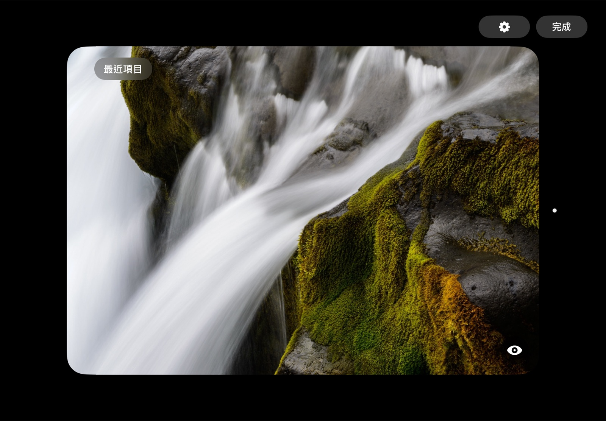 |

### 五種全螢幕時鐘

第三個畫面是全螢幕時鐘，**上下滑動**切換樣式：

| 類比 | 數字 |
| :---: | :---: |
|  | 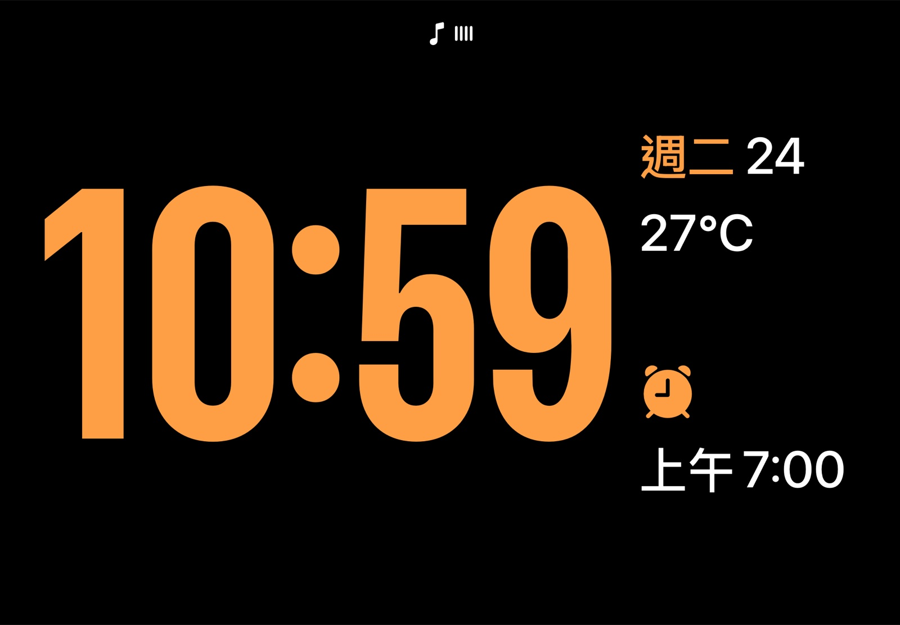 |
| 刻度從中心放射到螢幕邊緣，中間顯示鬧鐘與日期 | 超大窄體數字，右側顯示星期、溫度與鬧鐘 |
| **世界** | **太陽** |
| 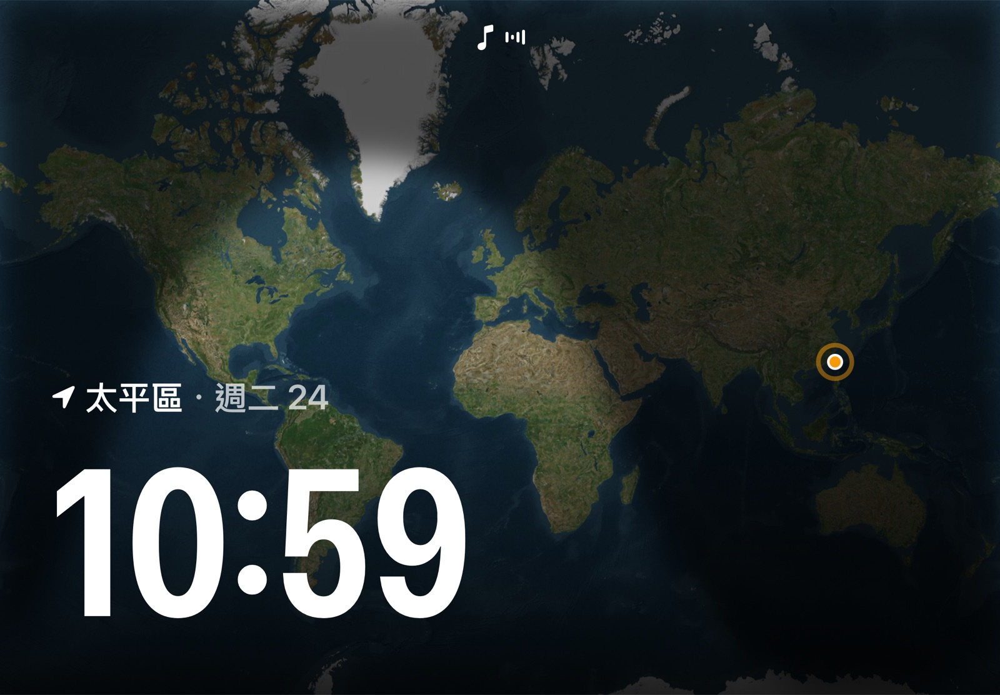 | 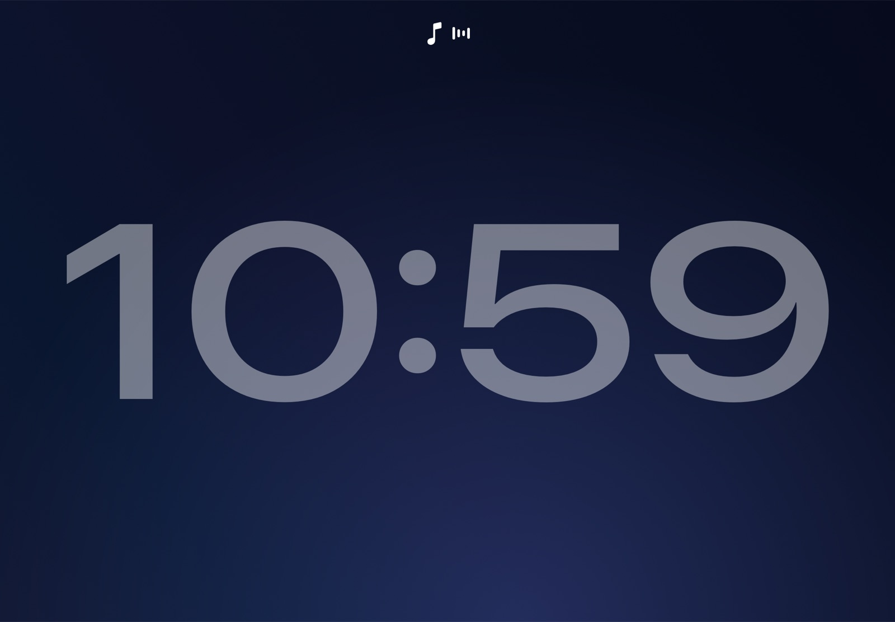 |
| 衛星世界地圖、即時晨昏線與你的位置 | 背景顏色依太陽高度從夜晚、日出到白天漸變 |
| **浮動** | **換顏色** |
| 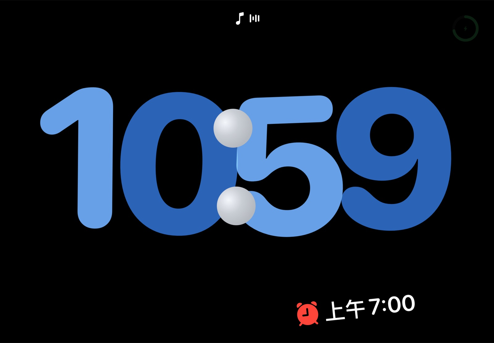 | 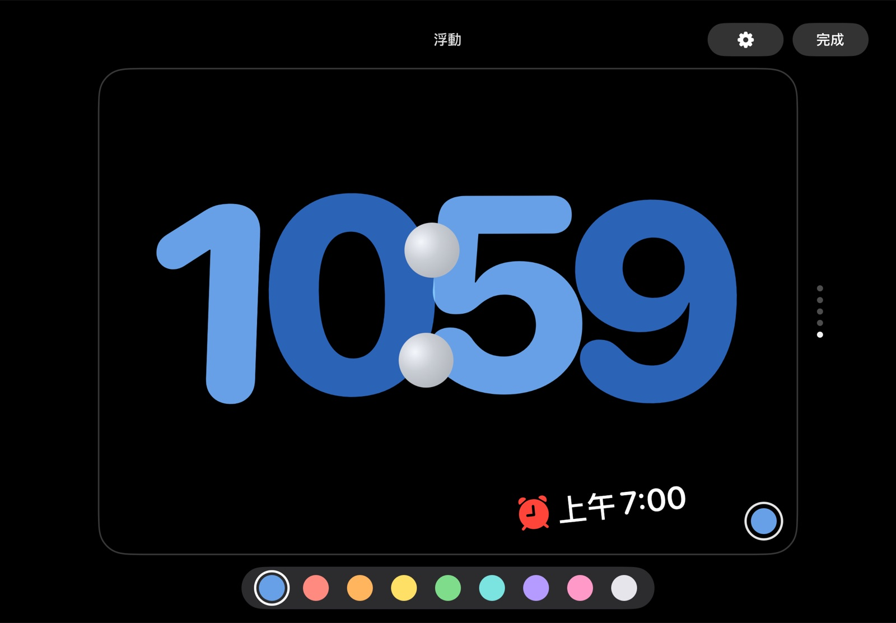 |
| 數字緩慢漂浮，冒號是兩顆小球 | 長按後點右下角色票，類比 9 色、數字 11 色、浮動 9 色 |

時間改變時，數字會以翻動的動畫切換。開啟「減少動態效果」時，漂浮與推近動畫會停止。

### 夜間模式

晚上或房間變暗時，整個畫面會轉成單色紅，減少藍光、不刺眼：

| 夜間模式：時鐘 | 夜間模式：小工具 |
| :---: | :---: |
| 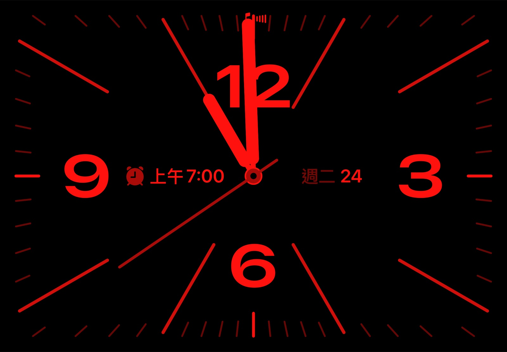 | 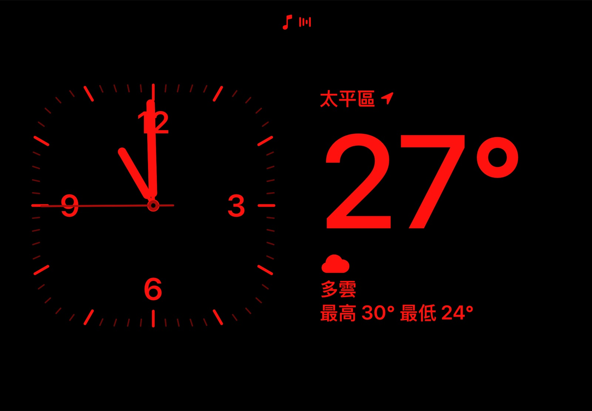 |

- **自動**：在設定的時段內（預設 22:00–06:00），或螢幕自動亮度降得很低時開啟。
- **永遠開啟**／**關閉**：手動切換。
- 可選「夜間降低螢幕亮度」。
- 可選「夜間閒置時讓畫面變黑」：閒置一段時間後畫面變黑、亮度降到最低，輕點即可喚醒，iPad 不會鎖定。

### 音樂與 Apple Music

App 讀取並控制 iPad 上「音樂」App 的播放器，所以在「音樂」App 播 Apple Music，這裡就會同步顯示。

- 播放中時，畫面上方會出現 ♪ 和跳動的等化器。暫停後 10 分鐘內仍會保留，方便重新開啟。
- 點 ♪ 展開**全螢幕播放器**：專輯封面、歌名、歌手、播放／暫停、上一首／下一首、音量、AirPlay、時間軸。上下或左右滑動即可收起。
- **音量條**可以直接拖曳，也能調整 AirPlay 裝置的音量。AirPlay 切換或重新連線時，系統偶爾會短暫回報音量 0，App 會先忽略這個值並重新確認，音量條不會突然跳到 0。
- Apple Music 串流歌曲沒有封面時，會改用 Apple 的 iTunes 搜尋服務補上封面。
- 點清單按鈕開啟**音樂資料庫**，從「最近播放」或「播放列表」直接挑歌播放。

| 全螢幕播放器 | 音樂資料庫 |
| :---: | :---: |
| 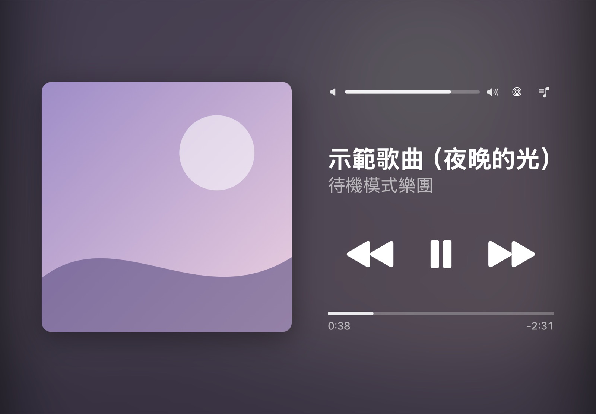 | 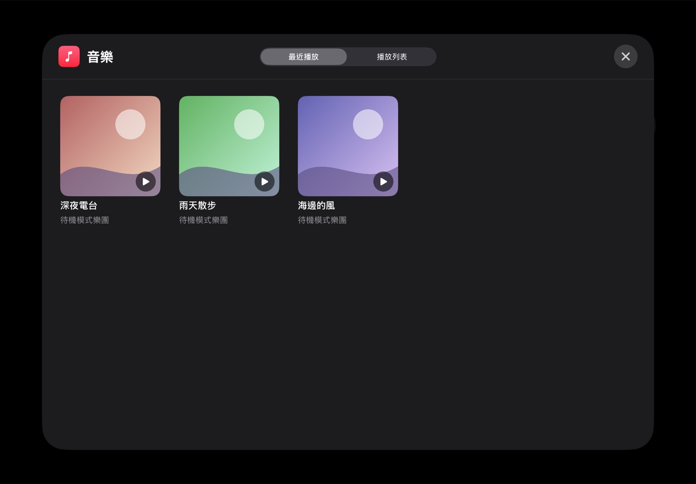 |

### 鬧鐘

在設定裡開啟鬧鐘並選擇時間後：

- 類比、數字、浮動時鐘與數字時鐘小工具都會顯示下一個鬧鐘。
- App 開著時，時間到會全螢幕響鈴，可選「稍後提醒」（9 分鐘）或「停止」。
- App 不在前景時，改以通知提醒。

### 歡迎畫面、充電動畫與永不休眠

- **歡迎畫面**：第一次開啟時顯示，按 × 或左右滑動即可開始。
- **充電動畫**：接上電源時，右上角的綠色電量圈會填滿到目前電量。
- **永不休眠**：App 開著時停用自動鎖定，並且每秒和每次回到前景都會再確認一次，避免被系統重設。

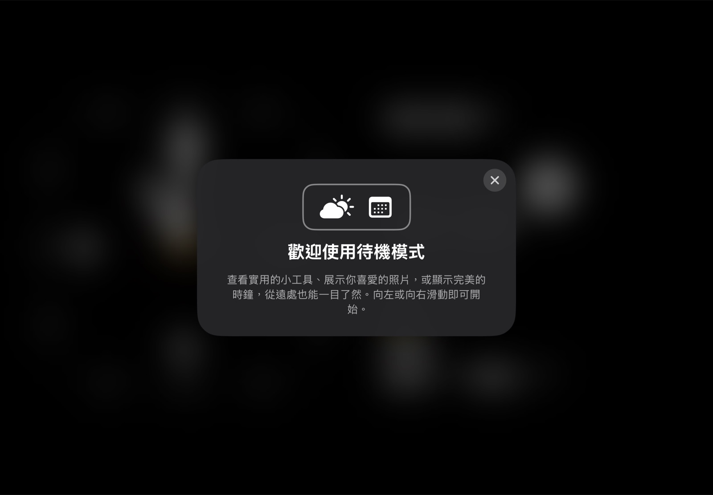

### 觸控、滑鼠與觸控板操作

| 動作 | 觸控 | 觸控板 | 滑鼠 |
| --- | --- | --- | --- |
| 切換三個畫面 | 左右滑動 | 雙指左右滑動 | 按住拖曳 |
| 切換小工具、相簿、時鐘樣式 | 上下滑動 | 雙指上下滑動 | 滾輪，或按住拖曳 |
| 進入編輯模式 | 長按 | 按住點按 | 按住左鍵 |
| 收起全螢幕播放器 | 上下或左右滑動 | 雙指滑動 | 滾輪，或按住拖曳 |
| 關閉歡迎畫面 | 左右滑動或點 × | 雙指左右滑動或點 × | 點 × |

使用滑鼠或觸控板時，指標移到按鈕上會顯示 iPadOS 的懸停效果。

### 鍵盤快捷鍵

接上實體鍵盤（例如巧控鍵盤）就能用：

| 按鍵 | 作用 |
| --- | --- |
| Option（單獨按一下） | 叫出或關閉音樂介面；沒有播放中的歌曲時打開音樂資料庫 |
| ↑ ／ ↓ | 調整音量（按住可連續調整），畫面上方會出現音量提示 |
| ← ／ → | 上一首／下一首 |

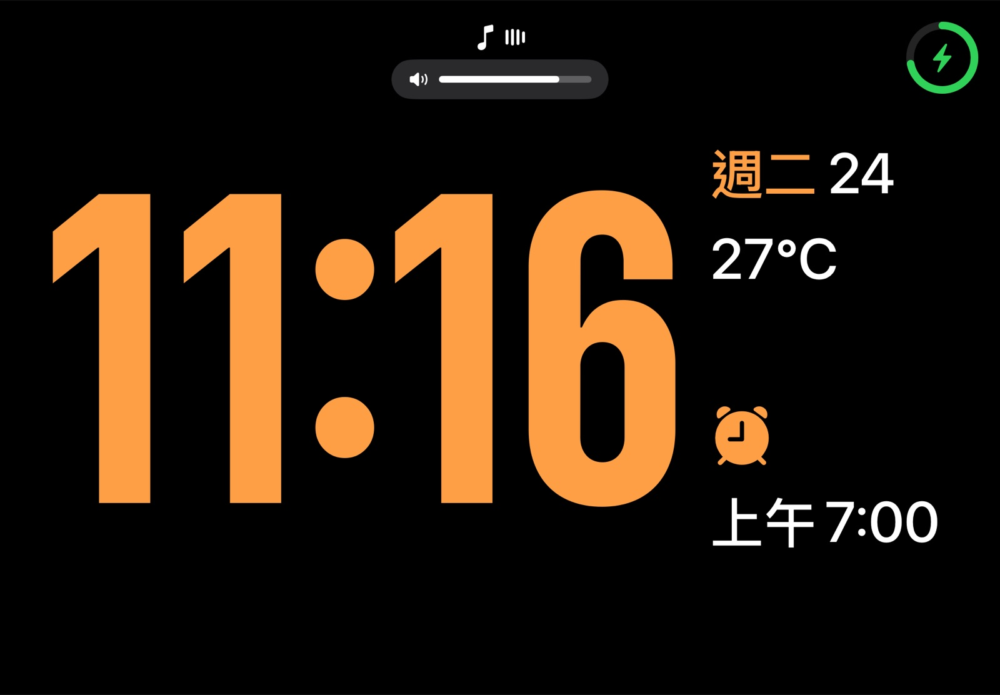

### 設定

在任一畫面長按進入編輯模式，點右上角的齒輪就能打開設定：

| 設定 | 設定（下方） |
| :---: | :---: |
| 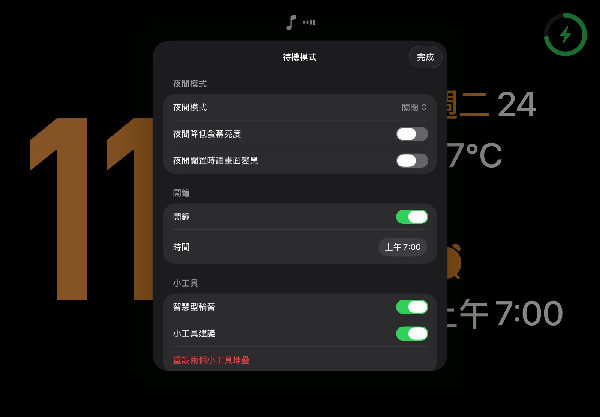 | 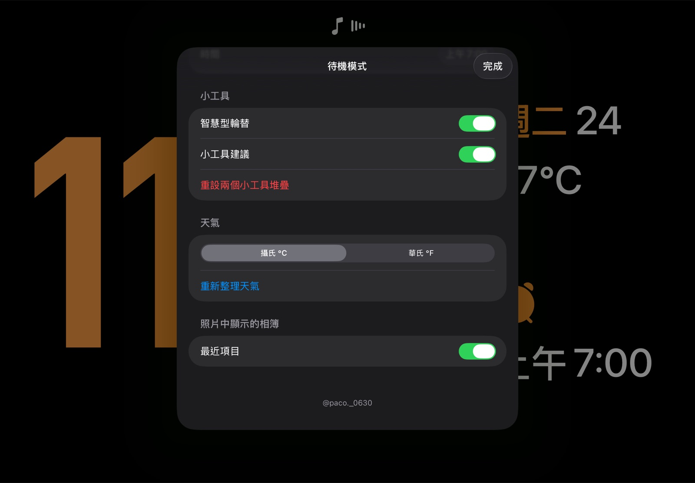 |

- **夜間模式**：自動／永遠開啟／關閉、開始與結束時間、降低螢幕亮度、閒置時讓畫面變黑。
- **鬧鐘**：開關與時間。
- **小工具**：智慧型輪替、小工具建議、重設兩個堆疊。
- **天氣**：攝氏或華氏、重新整理天氣。
- **照片**：選擇電子相框要顯示哪些相簿。

## 系統需求

- iPad，iPadOS 16.0 以上（針對 iPad Air 4 的 1180×820 橫向畫面設計，其他尺寸也能使用）。
- 只支援橫向。
- 編譯需要 Xcode 26 以上（專案使用 file-system synchronized groups）。

## 權限與隱私

每個權限都只在用到的時候才詢問，拒絕後其他功能照常運作。

| 權限 | 用途 |
| --- | --- |
| 位置（使用 App 期間） | 天氣、地區名稱、世界時鐘與太陽時鐘的日照位置 |
| 照片 | 電子相框與精選照片小工具 |
| 行事曆 | 即將到來小工具 |
| 媒體與 Apple Music | 顯示與控制「音樂」App 的播放、音樂資料庫 |
| 通知 | 開啟鬧鐘時，App 不在前景時以通知提醒 |

會連線的外部服務：

- [Open-Meteo](https://open-meteo.com/)：取得天氣，會送出你的大概位置（經緯度）。
- Apple iTunes 搜尋服務：歌曲沒有封面時，用歌名與歌手查封面。
- Apple 地圖：世界時鐘的衛星地圖。

App 沒有任何分析、廣告或帳號系統，設定只存在 iPad 本機。

## 聲明

本專案是個人作品，與 Apple Inc. 沒有任何關係，也未經 Apple 授權或背書。「StandBy」、「iPad」、「Apple Music」等為 Apple Inc. 的商標。

作者：@paco._0630

## 授權

本專案以 [PolyForm Noncommercial License 1.0.0](LICENSE) 授權。

- 可以用於任何非商業用途，例如個人使用、學習、研究、興趣專案，也可以修改和散布。
- 不可用於商業用途。
- 散布本專案或修改後的版本時，必須附上授權條款（或其網址）以及 `Required Notice:` 那一行版權聲明。

完整條款以 [LICENSE](LICENSE) 檔案的英文原文為準。
